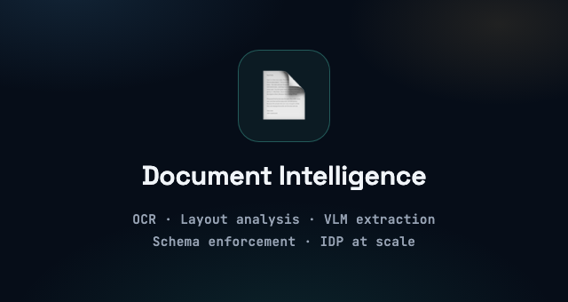

  

<h1 align="center">Christine Straub</h1>

  <strong>Lead ML/AI Engineer | Post-Training & RL | Document Intelligence | Agentic Systems</strong>

  I build training and evaluation infrastructure that makes models and agents reliable in production.

  
  
  
  

---

## 👋 About Me

> I work across the full model lifecycle — **pre-training, post-training, and fine-tuning** — and ship the **evaluation and infrastructure layers** that make AI systems hold up in the real world.

I'm a Lead ML/AI Engineer with 9+ years of experience shipping production AI systems across defense, healthcare, and enterprise software, including work connected to classified DoD programs and HIPAA-regulated environments. My deepest focus areas are reinforcement learning (SFT/DPO/GRPO, RL environment curation, deterministic verifiers), document intelligence (OCR, layout inference, VLM extraction), and multi-agentic workflows that plan, call tools, and hand off work reliably in production.

I've built RL training and evaluation infrastructure, OCR/layout pipelines processing millions of documents, RAG and agentic systems, speech/NLP analytics, model evaluation harnesses, and high-throughput inference systems — with merged contributions across 7 repositories in the Unstructured ecosystem.

  
  
  
  

## 🔬 Engineering Focus

<table>
  <tr>
    <td width="33%" align="center" valign="top">
      
    </td>
    <td width="33%" align="center" valign="top">
      
    </td>
    <td width="33%" align="center" valign="top">
      
    </td>
  </tr>
</table>

## 🌍 Open Source

> ### 📄 Unstructured Ecosystem
>
> Merged contributions across **7 repositories** in the [Unstructured](https://github.com/Unstructured-IO) ecosystem — the open-source standard for turning complex enterprise documents into LLM-ready data.

  

## 💼 Experience

### 🎯 Lead AI/ML Engineer · Bespokelabs AI

RL environments and evaluation infrastructure for coding agents — realistic task specs, reward signals, deterministic verifiers, and rollout analysis for failure modes and reward hacking.

### 📄 Senior AI/ML Engineer · Unstructured IO

Enterprise document processing and agentic workflows — multimodal extraction pipelines, MCP-based tool use, verifier functions, and reproducible benchmark tasks.

### 🏛️ Lead AI/ML Engineer · Medici Land Governance

Document intelligence for high-stakes legal and enterprise documents — hybrid OCR → VLM extraction with confidence-scored review and benchmark-driven evaluation.

### 🤖 Senior ML Engineer · RIOS Intelligent Machines

Computer vision and robotics for industrial automation — **10M+ images/day**, **70% deployment-time reduction** through MLOps automation, GPU and edge optimization.

## 🚀 Selected Work

<table>
  <tr>
    <td width="50%" valign="top">
      <h3>📄 <a href="https://github.com/Unstructured-IO">Unstructured.io</a></h3>
      
High-throughput document extraction pipelines for LLM ingestion, processing millions of complex documents with state-of-the-art layout analysis.

      
<strong>Merged PRs across 7 repos</strong> · Document AI · Python

      <a href="https://github.com/search?q=org%3AUnstructured-IO+author%3Achristinestraub&type=pullrequests">View contributions →</a>
    </td>
    <td width="50%" valign="top">
      <h3>🎯 <a href="https://github.com/christinestraub/web-search-agent-evals">web-search-agent-evals</a></h3>
      
Evaluation harness for web-search agents — reproducible benchmarks, scoring, and failure-mode analysis.

      
Agent Evals · TypeScript · Benchmarking

    </td>
  </tr>
  <tr>
    <td width="50%" valign="top">
      <h3>🏙️ <a href="https://duxre.com/">Duxre — DASH Chatbot</a></h3>
      
Multi-agent RAG engine for commercial real estate — complex task orchestration, asset analysis, and intelligent automation with built-in evaluation.

      
Multi-Agent · RAG · CRE

    </td>
    <td width="50%" valign="top">
      <h3>🛡️ <a href="https://sapientlogic.com/">Sapient Logic — COMET & POLAR</a></h3>
      
Mission-critical military intelligence systems and tactical mobile OCR for the DoD. Technical lead across both programs.

      
Defense · Tactical OCR · Classified Programs

    </td>
  </tr>
</table>

**More applied work:** 🤖 [RIOS AI](https://rios.ai/) industrial robotics MLOps · 🕸️ [Araya](https://araya.app/) healthcare EMR knowledge graphs · 🗣️ [Speechlab](https://www.speechlab.ai/) speech analytics · 🇺🇸 MyRuck AI veterans' benefits automation

## 🧭 Current Focus

> I'm focused on **RL environment design, deterministic verifiers, and evaluation infrastructure for agentic systems** — the layers that decide whether an agent is actually ready for production. Open to remote Reinforcement Learning, Post-Training, Document Intelligence, and Agentic AI roles.

## 🧰 Technical Skills

### 🎯 Post-Training & RL

`SFT` `DPO` `GRPO` `RLHF` `RL Environment Curation` `Deterministic Verifiers` `Reward Modeling` `Difficulty Calibration` `Benchmark Development`

### ✨ Generative AI & LLM Systems

`RAG` `Multimodal VLMs` `Long-Context Processing` `Structured Outputs` `Prompt Optimization` `Model Routing` `LLM/VLM Productization`

### 📄 Document Intelligence

`OCR` `Layout Analysis` `VLM Extraction` `Schema Enforcement` `Unstructured OSS` `PaddleOCR` `Tesseract` `Gemini` `Qwen3-VL`

### 🤖 Agent Systems & Evaluation

`Multi-Agent Orchestration` `MCP` `LLM Routing` `Tool Use` `Agent Training` `Evaluation Pipelines` `Data Curation at Scale` `LLMOps`

### ⚙️ Training & Inference Infrastructure

`DeepSpeed` `Megatron-LM` `SGLang` `vLLM` `TensorRT-LLM` `Distributed Training` `Continuous Batching` `KV Cache Optimization` `Quantization`

### ☁️ MLOps & Platform

`Metaflow` `GPU Inference` `Model Serving` `Cloud ML Pipelines` `BigQuery` `CI/CD`

## 🎓 Education & Credentials

**B.A. Computer Science** & **B.A. Cognitive Science**, UC Berkeley

Machine Learning Specialization (Stanford) · Deep Learning Specialization (DeepLearning.AI) · IBM Data Science · AWS Cloud Practitioner · CSPO (Scrum Alliance)

## 🤝 Connect

I'm interested in conversations around reinforcement learning, post-training, evaluation infrastructure, document intelligence, and production agentic systems.

- Portfolio: [christinemstraub.com](https://christinemstraub.com)
- Email: [christinemstraub@gmail.com](mailto:christinemstraub@gmail.com)
- LinkedIn: [straubchristine](https://www.linkedin.com/in/straubchristine/)
- Notion: [ML Portfolio](https://christinestraub.notion.site/ml)

  From pre-training to production — systems that hold up in the real world.

