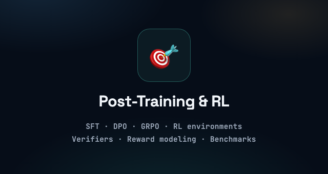
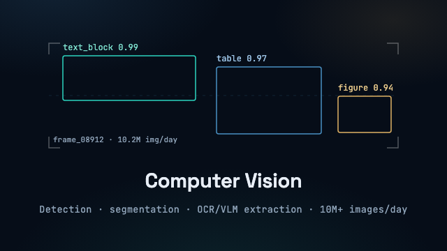
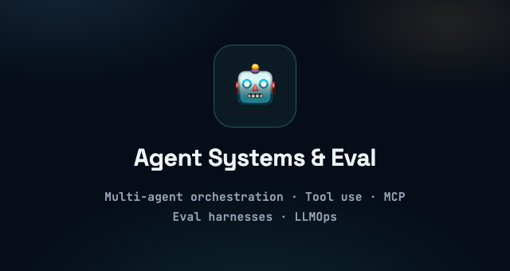

<!-- Owner: Christine Straub. Last reviewed: 2026-10-10.
     Review triggers: role change, new OSS milestone, portfolio redesign, job search start or end. -->

  

<h1 align="center">Christine Straub</h1>

  <strong>Lead ML/AI Engineer | Reinforcement Learning | Computer Vision | Multi-Agentic Systems</strong>

  📍 San Clemente, California · 🤖 Technical Lead, Machine Learning Engineer · 🚀 9+ Years

  I build RL environments, computer vision pipelines, and multi-agent systems that survive production.

  
  
  
  

---

## 🔬 Engineering Focus

<table>
  <tr>
    <td width="33%" align="center" valign="top">
      
    </td>
    <td width="33%" align="center" valign="top">
      
    </td>
    <td width="33%" align="center" valign="top">
      
    </td>
  </tr>
</table>

## 👋 About Me

> I work across the full model lifecycle (**pre-training, post-training, and fine-tuning**) and ship the **evaluation and infrastructure layers** that make AI systems hold up in the real world.

I'm a Lead ML/AI Engineer with 9+ years of experience shipping production AI systems across defense, healthcare, and enterprise software, including work connected to classified DoD programs and HIPAA-regulated environments. My deepest focus areas are reinforcement learning (SFT/DPO/GRPO, RL environment curation, deterministic verifiers), computer vision (production detection, segmentation, and OCR/VLM extraction at 10M+ images/day), and multi-agentic workflows that plan, call tools, and hand off work reliably in production.

I've built RL training and evaluation infrastructure, real-time vision systems for industrial robotics, OCR/layout pipelines processing millions of documents, RAG and agentic systems, speech/NLP analytics, model evaluation harnesses, and high-throughput inference systems, with merged contributions across 7 repositories in the Unstructured ecosystem.

- **Reinforcement Learning & Post-Training:** SFT, DPO, online RL/GRPO, RL environment curation, difficulty calibration, reward modeling, deterministic verifiers, and model-based RL environments
- **Computer Vision:** Production detection and segmentation, OCR/layout analysis, VLM extraction, real-time video analytics, GPU/edge deployment, 10M+ images/day pipelines
- **Multi-Agentic Systems & Evaluation:** Multi-agent orchestration, LLM routing, agent training, tool use, MCP, benchmark development, data curation at scale, evaluation pipelines, and LLMOps/MLOps
- **Document Intelligence:** Schema enforcement, intelligent document processing, Unstructured OSS, PaddleOCR, Tesseract, Gemini, Qwen3-VL
- **Speech Analytics & NLP:** Speech-to-text pipelines, segmentation, sentiment analysis, BERT-based classification, conversational intelligence, and voice-data extraction
- **Generative AI & LLM Systems:** RAG, multimodal VLMs, long-context processing, prompt optimization, structured outputs, model routing, and LLM/VLM productization
- **LLM Training & Inference Infrastructure:** DeepSpeed, Megatron-LM, SGLang, vLLM, TensorRT-LLM, distributed training/inference, tensor/pipeline/expert parallelism, continuous batching, KV cache optimization, quantization, and API serving

  
  
  
  

## 🌍 Open Source

> ### 📄 Unstructured Ecosystem
>
> Merged contributions across **7 repositories** in the [Unstructured](https://github.com/Unstructured-IO) ecosystem, the open-source standard for turning complex enterprise documents into LLM-ready data.

  

## 💼 Experience

### 🎯 Lead Reinforcement Learning Engineer and Machine Learning Engineer · [Bespokelabs AI](https://www.bespokelabs.ai/)

RL environments and evaluation infrastructure for coding agents: realistic task specs, reward signals, deterministic verifiers, and rollout analysis for failure modes and reward hacking.

### 📄 Senior Machine Learning Engineer · [Unstructured IO](https://unstructured.io/)

Enterprise document processing and agentic workflows: multimodal extraction pipelines, MCP-based tool use, verifier functions, and reproducible benchmark tasks.

### 🏛️ Lead AI and Machine Learning Engineer · [Medici Land Governance](https://mediciland.com/)

Document intelligence for high-stakes legal and enterprise documents: hybrid OCR → VLM extraction with confidence-scored review and benchmark-driven evaluation.

### 🤖 Senior Machine Learning Engineer · [RIOS Intelligent Machines](https://rios.ai/)

Computer vision and robotics for industrial automation: **10M+ images/day**, **70% deployment-time reduction** through MLOps automation, GPU and edge optimization.

### 📈 Software Engineer · [Moody's Analytics](https://www.moodysanalytics.com/)

Catastrophe risk modeling and location intelligence platforms (RMS(one), RiskLink, RiskBrowser): client-facing catastrophe risk assessment and portfolio analysis features for insurers evaluating multi-billion dollar portfolios.

## 🏆 Key Projects & Impact

### 🤖 Generative AI & Product Engineering

- 📄 [**Unstructured.io**](https://github.com/Unstructured-IO) – **Engineered** high-throughput data extraction pipelines for LLM ingestion, processing millions of complex documents with state-of-the-art layout analysis (**Senior Machine Learning Engineer**).
- 🏙️ [**Duxre**](https://duxre.com/) – **Architected** the DASH Chatbot’s multi-agent RAG engine, enabling complex CRE task orchestration and streamlining asset analysis through intelligent automation and evaluation (**AI/ML Tech Lead**).
- ✍️ [**Averi AI**](https://www.averi.ai/) – **Developed** a GenAI marketing copilot leveraging LLMs for automated content optimization and brand-aligned strategy generation (**AI/ML Tech Lead**).
- 🗣️ [**Speechlabs**](https://www.speechlab.ai/) – **Advanced** NLU capabilities for next-gen audio analysis, implementing high-accuracy sentiment tracking and speech processing pipelines (**Senior Software Architect**).
- 🕸️ [**Araya**](https://araya.app/login) – **Architected** an **AI-driven healthcare EMR system**, implementing Knowledge Graphs and semantic search to unlock latent clinical insights from enterprise-scale unstructured medical data (**AI/ML Tech Lead**).
- 🇺🇸 **MyRuck AI** – **Spearheaded** a full-stack HR automation platform connecting veterans to benefits via intelligent RAG-driven government API integrations (**AI/ML Tech Lead**).
- 🎓 **WeStepForward** – **Built** adaptive exam preparation platforms featuring personalized, AI-driven learning paths and retrieval-augmented study aids (**AI/ML Tech Lead**).

### 👁️ Computer Vision & AI

- 🏛️ [**Medici Land Governance**](https://mediciland.com/) – **Working on** blockchain-based land administration, high-volume Intelligent Document Processing (IDP) systems (**Lead AI and Machine Learning Engineer**).
- 🤖 [**RIOS AI**](https://rios.ai/) – **Built production MLOps pipelines** for industrial robotics, orchestrating real-time video anomaly detection and closing the data-to-annotation loop (**Senior Machine Learning Engineer**).
- 🍍 [**Eastern Kentucky University**](https://www.eku.edu/) – **Pioneered** drone-based Computer Vision systems for agricultural spatial analytics, optimizing crop yields in developing regions (**Senior ML Engineer**).
- 🧬 [**Specific Diagnostics**](https://www.sbir.gov/portfolio/406405) – **Accelerated** bacterial infection diagnostics using AI-powered computer vision and high-precision signal processing (**Senior ML Engineer**).

### ⚙️ Advanced MLOps, Production Data Engineering, Machine Learning

- 🕵️‍♀️ [**Memetica**](https://memetica.co/) – **Designed scalable** threat intelligence infrastructure and digital investigation pipelines for real-time tracking of disinformation (**Senior Data Engineer**).
- 🛡️ [**Sapient Logic (COMET & POLAR)**](https://sapientlogic.com/) – **Technical Lead** for mission-critical military intelligence systems and tactical mobile OCR solutions for the DoD (**AI/ML Tech Lead**).
- 🎓 [**Collegis Education**](https://collegiseducation.com/) – **Optimized** higher education analytics engines using real-time GCP data pipelines and predictive modeling for enrollment growth (**Senior Data Engineer/Scientist**).
- 📦 [**Inxeption**](http://inxeptionpay.com/) – **Engineered** logistics pricing engines and vendor management systems processing massive transaction volumes with sub-second latency (**Senior Data Engineer/Scientist**).
- 🧠 [**Soul Machines**](https://www.soulmachines.com/) – **Architected** conversational AI for hyper-realistic "Digital People," enhancing student engagement via sentiment-aware interaction models (**Senior ML Engineer**).
- 🔐 [**Sapient Logic (Cybersecurity)**](https://sapientlogic.com/) – **Developed** semantic similarity engines mapping cyber threats to the MITRE ATT&CK framework for automated defense (**Senior ML Engineer**).
- 📊 **DeepChannel** – **Optimized** custom ETL pipelines and data warehousing solutions for high-performance, sub-second analytics (**Senior AI/ML Engineer**).
- 🔍 [**DQLabs**](https://www.dqlabs.ai/) – **Engineered** Deep Learning solutions for automated data quality assurance and semantic type detection across massive datasets (**Senior AI/ML Engineer**).
- 📈 [**EMCA**](https://www.emca-online.eu/) – **Deployed** advanced time-series forecasting models for real-time operational anomaly detection and resource optimization (**Senior ML Engineer**).
- 📞 [**Plus One Company**](https://plusonecompany.com/) – **Implemented** an NLP-powered call analysis platform extracting actionable business intelligence from voice data at scale (**Senior ML Engineer**).
- 📈 [**Moody's Analytics**](https://www.moodysanalytics.com/) – **Built** client-facing catastrophe risk modeling and portfolio analysis features across the RMS(one), RiskLink, and RiskBrowser platforms, enabling insurers to evaluate multi-billion dollar portfolios (**Software Engineer**).

## 🧭 Current Focus

> I'm focused on **RL environment design, deterministic verifiers, and evaluation infrastructure for agentic systems**, the layers that decide whether an agent is actually ready for production. Open to remote Reinforcement Learning, Post-Training, Computer Vision, and Multi-Agentic Systems roles.

## 🧰 Technical Skills & Tools

### 🎯 Reinforcement Learning & Post-Training

`SFT` `DPO` `GRPO` `RLHF` `RL Environment Curation` `Deterministic Verifiers` `Reward Modeling` `Difficulty Calibration` `Benchmark Development`

### 🤖 Multi-Agentic Systems & Evaluation

`Multi-Agent Orchestration` `MCP` `LLM Routing` `Tool Use` `Agent Training` `Evaluation Pipelines` `Data Curation at Scale` `LLMOps`

### 👁️ Computer Vision

`Object Detection` `Multi-Object Tracking` `Segmentation` `OCR` `VLM Extraction` `Edge Deployment` `Real-Time Inference`

### 📄 Document Intelligence

`Layout Analysis` `Schema Enforcement` `Intelligent Document Processing` `Unstructured OSS` `PaddleOCR` `Tesseract` `Gemini` `Qwen3-VL`

### ✨ Generative AI & LLM Systems

`RAG` `Multimodal VLMs` `Long-Context Processing` `Structured Outputs` `Prompt Optimization` `Model Routing` `LLM/VLM Productization`

### ⚙️ Training & Inference Infrastructure

`DeepSpeed` `Megatron-LM` `SGLang` `vLLM` `TensorRT-LLM` `Distributed Training` `Continuous Batching` `KV Cache Optimization` `Quantization`

### 🧮 Languages & Core ML

### ☁️ Cloud, MLOps & Data

### 🌐 Full Stack Development

## 🎓 Education & Credentials

**B.A. Computer Science** & **B.A. Cognitive Science**, UC Berkeley

Machine Learning Specialization (Stanford) · Deep Learning Specialization (DeepLearning.AI) · IBM Data Science · AWS Cloud Practitioner · CSPO (Scrum Alliance)

## 🤝 Connect

I'm interested in conversations around reinforcement learning, computer vision, evaluation infrastructure, and production multi-agent systems.

🌐 [Portfolio (start here)](https://christinemstraub.com) | 📝 [Notion (case-study archive)](https://christinestraub.notion.site/Christine-Straub-ML-Portfolio-2f328fbe27068053b029f28ffe86cde9) | 📧 [Email](mailto:christinemstraub@gmail.com) | 👔 [LinkedIn](https://www.linkedin.com/in/straubchristine/)

  Models that learn. Agents that ship. Systems that hold up in the real world.

